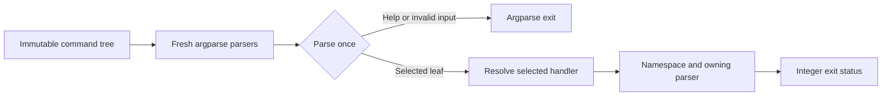

# Argivore

[](https://github.com/astrivant/argivore/blob/coverage/badges/coverage.json)

Build nested Python CLIs from reusable command declarations. Argivore composes
standard-library `argparse` parsers, preserves normal help and error behavior,
and imports an optional runtime only after its command has been selected.

<!-- toc:start -->
**Table of contents**

- [Quick start](#quick-start)
- [Benefits](#benefits)
- [Compose a command tree](#compose-a-command-tree)
- [Architecture](#architecture)
- [Development and releases](#development-and-releases)
- [License](#license)
<!-- toc:end -->

## Quick start

Requires Python 3.12 or newer, excluding 3.14.1. The first PyPI release is v0.0.1;
the command below becomes available when its release pipeline publishes it.

```bash
python -m pip install argivore
argivore demo greet --name Ada
```

Expected output: `Hello, Ada!`. Use `argivore --version` to inspect the installed
release. See [development](docs/development.md) to run from source before publication.

## Benefits

- Compose groups at every level using one immutable declaration type.
- Mount the same subtree standalone or beneath another CLI.
- Keep expensive imports and service connections out of help and invalid-input paths.
- Give handlers the complete parsed namespace and their own parser for useful errors.
- Retain argparse options, aliases, exit codes and documentation conventions.

## Compose a command tree

```python
from argivore import Command, LazyHandler

root = Command(
    "acme",
    "Manage a deployment",
    children=(
        Command(
            "jobs",
            "Manage jobs",
            children=(
                Command(
                    "list",
                    "List active jobs",
                    handler=LazyHandler("acme.runtime.jobs", "list_jobs"),
                ).with_aliases("ls"),
            ),
        ),
    ),
)

# Parse once at the application boundary; only the selected runtime is imported.
raise SystemExit(root.run())
```

This exposes `acme jobs list`, `acme jobs ls`, and help at each level. The runtime
function accepts `(args: argparse.Namespace, parser: argparse.ArgumentParser)`
and returns an integer exit status. A normal callable also works as `handler`.
See the [API guide](docs/api.md) for local options, shared ancestor options,
standalone parsers and error handling.

## Architecture



Declarations own names, aliases and argument builders. Fresh parsers own mutable
parsing state. A private leaf binding connects the selected handler to its parser;
groups need no shared routing field. Argument builders run during parser creation,
so they should declare inputs without opening services or importing heavy runtimes.

## Development and releases

The [development guide](docs/development.md) covers locked installs, tests, hooks
and package checks. CI tests Python 3.12 through 3.15 on Linux, plus 3.15 on macOS.
The coverage badge is generated from an accepted main-branch test report and links
to its source revision; its initial publication follows the first merge.

[Signed releases](docs/releases.md) contain the wheel, source archive, checksums,
signature bundles and source provenance. The [repository review](docs/repository-review.md)
records the validation boundaries. [SKILL.md](SKILL.md) is the agent entrypoint.
See [Contributing](CONTRIBUTING.md) for the review workflow and
[Security](SECURITY.md) for private vulnerability reporting and version support.

## License

Argivore's independently implemented Python runtime is [Apache-2.0](LICENSE).
The [NOTICE](NOTICE) contains stable attribution; release-specific revisions live
in signed provenance. Repository-only development helpers retain their separate
[notices](scripts/NOTICE.md) and are excluded from both package distributions.
